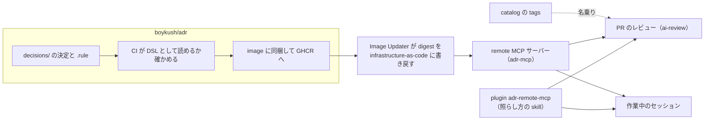

# 決定が変更に届くまで

boykush/adr に書いた決定は、各 repo へ複製されない。ルールとして remote MCP サーバーから配られ、PR のレビューや作業中のセッションが、それに変更を照らす。このページは、その流れが**何を保証していて、どこで遅れ、どう止まって見えるか**を書く。

決定の書き方や MCP の面の細部は [README](https://github.com/boykush/adr#readme) が、関わる repo と関係は Backstage の catalog（この System と `adr-mcp` の Graph）が持つので、ここでは繰り返さない。

## 保証していること

- **縛るのはルールだけ。** 各 repo が守るのは、accepted な決定に付いた `.rule` だけ。決定の本文は、ルールの理由を知りたいときに読むもの。ルールを持たない決定も、決定のうちルールに書かなかった部分も、誰も縛らない。
- **参照先は1つ。** 決定は各 repo に写さないので、決め直しはこの repo を変えるだけで全 repo に届く。逆に言えば、ここを変えない限りどの repo の振る舞いも変わらない。
- **届く先は repo が名乗った性質で決まる。** tag の付いた決定は、同じ tag を名乗った repo にだけ届く。名乗りは catalog の、その repo の Component の `metadata.tags` が持つ。tag の無い決定は全 repo に届く。
- **照らせないなら通さない。** PR のレビュー（ai-review）は、MCP サーバーに繋がらなければ失敗する。繋がらないまま走らせると、決定を1つも読まずに承認してしまうため。
- **配る側は読むことしかできない。** サーバーは認証を持たずに公開している。決定は元から public なので読まれて困るものは無く、その代わり書き込みの面を一切出さない。

## 流れ

照らす側は2つで、どちらもルールの取り方は同じ（`list_rules`）。違うのは、いつ照らし、違反をどう扱うか。

| | PR のレビュー | 作業中のセッション |
| --- | --- | --- |
| どこで | ai-review を入れた repo の PR | ai-review の無い repo（private を含む） |
| いつ | PR が開いた・push されたとき | 作業を終えて push する前 |
| 違反があったら | Claude GitHub App が変更を求める。無ければ承認する | セッションが直す。破らないと成り立たないなら人に言う |
| tag の名乗り | ai-review が catalog から読んで渡す | repo の `apm.yml` に書く |

## merge してから効くまで

この流れには、届き方の違う2本の道がある。直したものがどちらに乗るかで、効くまでの時間が変わる。

**ルールと決定の変更は、image の道を通る。** `decisions/` への push で image が作り直され、Image Updater がその digest を infrastructure-as-code に書き戻し、Argo CD が入れ替えたところで初めて配られる。merge しただけでは、PR のレビューも、セッションも、まだ古いルールで照らしている。

**照らし方の変更は、package の道を通る。** skill（`adr-check` / `adr-review` / `ade-rule-dsl`）と接続先は plugin `adr-remote-mcp` が持ち、[ai-plugins](https://github.com/boykush/ai-plugins) が package にして配る。受け取る側は SHA で固定しているので、Renovate がその SHA を上げるまで届かない。ai-review の場合は [workflows](https://github.com/boykush/workflows) の `apm.yml` が固定していて、さらに各 repo の caller が workflows を SHA で固定しているので、2段階かかる。セッションの場合は、Renovate の PR を merge したあと `apm install` を回して初めて手元が変わる。

## 止まって見えるとき

| 見えること | 何が起きているか | どうする |
| --- | --- | --- |
| 夜中に ai-review が失敗する | サーバーを載せた cluster が夜間止まっている（[infrastructure-as-code の node-pool-park](https://github.com/boykush/infrastructure-as-code/blob/main/.github/workflows/node-pool-park.yml)）。上の「照らせないなら通さない」の通り | 朝に re-run する。待てないなら owner が bypass で merge する |
| 決定を足したのに、レビューがそれを知らない | image の道の途中。まだ配られていない | Image Updater の書き戻しと Argo CD の同期を待つ |
| Go の repo なのに Go の決定で照らされない | その repo が tag を名乗っていない。ai-review の log に名乗った tag が出る | catalog の Component に tag を付ける |
| Claude で初回に `adr` の承認を求められる | project scope の MCP サーバーは repo ごとに承認が要る | 一度承認する（[plugin の README](https://github.com/boykush/adr/blob/main/plugins/adr-remote-mcp/README.md#使う)） |

## 何かを変えたいとき

| 変えたいこと | 持ち主 |
| --- | --- |
| 決定を足す・選び直す | この repo の skill `write-adr` |
| 決定にルールを付ける | この repo の skill `write-ade-rule` |
| repo が名乗る tag | その repo の `catalog-info.yaml` の Component（語の決まりは [README のタグ](https://github.com/boykush/adr#タグ)） |
| ある repo に PR のレビューを入れる | [workflows の README](https://github.com/boykush/workflows#ai-review) |
| サーバーの動く場所と公開ホスト名 | infrastructure-as-code の `applications/remote-mcp-server/adr/` |
