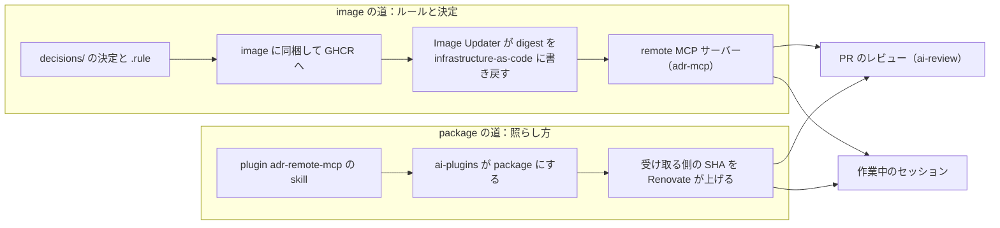

# 決定が変更に届くまで

boykush/adr に書いた決定は、各 repo へ複製されない。ルールとして remote MCP サーバーから配られ、PR のレビューや作業中のセッションが、それに変更を照らす。このページは、その仕組みが**常に守っている原則**と、**変更が届くまでの流れ**を書く。

決定の書き方や MCP の面の細部は [README](https://github.com/boykush/adr#readme) が、関わる repo と関係は Backstage の catalog（この System と `adr-mcp` の Graph）が持つので、ここでは繰り返さない。

## 原則

各原則は、何が常に成り立つか（原則）・なぜか（理由）・その結果どうなり、何を外すと崩れるか（含意）で書く。

### 1. ルールだけが縛る

**原則**　各 repo が守るのは、accepted な決定に付いた `.rule` だけ。決定の本文は誰も縛らない。

**理由**　決定の散文は、どの repo について言っているのかを名指さないと語れない。ルールの DSL は主語を取らず、読んだ repo についての言明になるので、各 repo が何を守るかはルールでしか書けない。

**含意**

- ルールの無い決定と、決定のうちルールに書かなかった部分は、どの repo にも効かない。効かせたいなら、その決定にルールを書く（skill `write-ade-rule`）。
- ルールを実行して確かめる仕組みは無い。PR のレビューや作業中のセッションが、差分をルールに照らして読む。
- 決定は、ルールの理由を知りたいときに読むもの。

### 2. 参照先は1つ

**原則**　決定もルールも、この repo にしか無い。各 repo へは写さない。

**理由**　写すと、決め直すたびに写しの数だけ直すことになり、直し漏れた repo が古い決定に従い続ける。

**含意**

- 決め直しは、この repo を変えるだけで全 repo に届く。ただし届くのは配られてから（下の「流れ」の image の道）。
- 各 repo の `AGENTS.md` などに決定の中身を書き写すと、この原則が崩れる。repo の側で守り方を書くなら、決定ではなく、その repo の事情だけを書く。

### 3. 届く先は repo が名乗った性質で決まる

**原則**　tag の付いた決定とそのルールは、同じ tag を名乗った repo にだけ届く。tag の無い決定は全 repo に届く。

**理由**　「Go の repo なら」のような条件は、ルールのパスでは書けない。repo が何であるかを repo 自身に名乗らせ、条件をルールの外で持つ。

**含意**

- 名乗りは、その repo の `catalog-info.yaml` にある Component の `metadata.tags`。PR のレビューはそこから読み、作業中のセッションは repo の `apm.yml` の宣言で渡す。
- 名乗り漏れは、黙って照らすルールが減る形で現れる。ai-review の log に、名乗った tag が出る。
- tag は決定の話題ではなく repo の性質で立てる（[README のタグ](https://github.com/boykush/adr#タグ)）。話題で立てると、repo の側が名乗れない。

### 4. 照らせないなら通さない

**原則**　PR のレビューは、ルールを読めないまま変更を承認しない。

**理由**　MCP サーバーに繋がらないセッションは、ルールを1つも読まずに走り切れてしまう。それを承認と区別できない。

**含意**

- サーバーを載せた cluster は夜間止まる（[infrastructure-as-code の node-pool-park](https://github.com/boykush/infrastructure-as-code/blob/main/.github/workflows/node-pool-park.yml)）ので、その間の ai-review は失敗する。朝に re-run するか、待てないなら owner が bypass で merge する。
- これを支えているのは、[workflows の ai-review](https://github.com/boykush/workflows/blob/main/.github/workflows/ai-review.yml) が最初に繋がるかを確かめる step。外すと、夜間の PR が黙って承認される。

### 5. 配る側は読むことしかできない

**原則**　MCP サーバーは決定とルールを返すだけで、書き込みの面を持たない。

**理由**　認証を持たずに公開している。決定は元から public なので読まれて困るものは無いが、書けるなら誰でも変えられることになる。

**含意**

- 決定とルールを変える道は、この repo への PR だけ。
- サーバーに書き込みの tool を足すなら、前段の認証が先に要る。足さない限り、公開のままでよい。

## 流れ

変更が届く道は2本ある。直したものがどちらに乗るかで、効くまでの時間が変わる。

| | image の道 | package の道 |
| --- | --- | --- |
| 乗るもの | 決定と `.rule` | skill（`adr-check` / `adr-review` / `ade-rule-dsl`）と接続先 |
| merge してから待つもの | image の build、Image Updater の書き戻し、Argo CD の入れ替え | Renovate の bump（`apm install` の生成物まで同じ commit に入り、automerge される）。ai-review は [workflows](https://github.com/boykush/workflows) の `apm.yml` と各 repo の caller の2段 |
| 待っている間に起きること | レビューもセッションも古いルールで照らす | レビューもセッションも古い手順で照らす |

照らす側は2つで、ルールの取り方（`list_rules`）は同じ。違うのは、いつ照らし、違反をどう扱うか。

| | PR のレビュー | 作業中のセッション |
| --- | --- | --- |
| どこで | ai-review を入れた repo の PR | ai-review の無い repo（private を含む） |
| いつ | PR が開いた・push されたとき | 作業を終えて push する前 |
| 違反があったら | Claude GitHub App が変更を求める。無ければ承認する | セッションが直す。破らないと成り立たないなら人に言う |

## 何かを変えたいとき

| 変えたいこと | 持ち主 |
| --- | --- |
| 決定を足す・選び直す | この repo の skill `write-adr` |
| 決定にルールを付ける | この repo の skill `write-ade-rule` |
| repo が名乗る tag | その repo の `catalog-info.yaml` の Component |
| ある repo に PR のレビューを入れる | [workflows の README](https://github.com/boykush/workflows#ai-review) |
| サーバーの動く場所と公開ホスト名 | infrastructure-as-code の `applications/remote-mcp-server/adr/` |
| 原則そのものを選び直す | 新しい決定として、この repo に ADR を書く |
