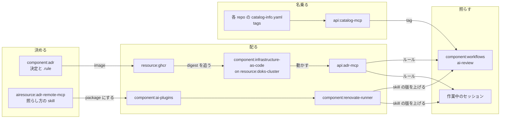

# 決定が変更に届くまで

## この System がもたらすもの

boykush 配下の repo に横断して効く技術的な意思決定を一度だけ決め、それが求めるルールを、決定が当てはまる repo の変更に届ける。repo が増えても、一つひとつで同じ問いを決め直さずに済み、全体が同じ答えに揃う——統制が、人の目ではなく仕組みで効く。

- **一度決めれば、全 repo が揃う。** 「ツールの版はどこで宣言するか」「GITHUB_TOKEN で足りない workflow は何で認証するか」のような、repo ごとに答えが割れがちな問いを [decisions/](https://github.com/boykush/adr/tree/main/decisions) で一度だけ決める。決め直しも、ここを変えるだけで全 repo に及ぶ。
- **当てはまる repo にだけ効く。** 「Go の静的解析に何を使うか」のような決定は、Go の repo にだけ届く。全 repo に当てる決定と、性質の合う一部の repo に当てる決定を、同じ置き場で持てる。
- **決めたことが、実際の変更で守られる。** 決定は読まれることを当てにしない。PR のレビューと作業中のエージェントが、変更をルールに照らし、違反を入る前に指摘する。決めた側が各 repo を見回らなくても、外れた変更はそこで見つかる。

このページの残りは、それを誰がどう担っているか——**全体像**と、**変更が届くまで**——を書く。決定の書き方や MCP の面の細部は [README](https://github.com/boykush/adr#readme) が、関係の正確な一覧は Backstage の catalog（この System と `adr-mcp` の Graph）が持つ。

## 全体像

System `adr` に入っているのは boykush/adr の entity だけで、仕組みを動かすのは周りの repo と基盤。役割は、決める・配る・照らす・名乗るの4つに分かれる。

### 決める

| entity | この System での責務 |
| --- | --- |
| `component:adr` | 決定（MADR）と、決定が各 repo に求める形を ADE の DSL で書いたルール（`.rule`）を持つ。配る CLI の adi と一緒に image にして、GHCR へ push するまでが責務 |
| `api:adr-mcp` | 決定とルールを配る口。repo が名乗った tag で絞って返す。読み取り専用で、認証なしで公開している（決定は元から public） |
| `airesource:adr-remote-mcp` | `adr-mcp` への接続先と、ルールの読み方・照らし方の skill（`ade-rule-dsl` / `adr-check` / `adr-review`）を束ねた plugin |

### 配る

| entity | この System での責務 |
| --- | --- |
| `resource:ghcr` | adr の image の置き場 |
| `component:infrastructure-as-code` | `adr-mcp` を cluster で動かし、公開する。Image Updater（`resource:image-updater-app`）が GHCR の新しい digest を main に書き戻し、Argo CD が入れ替える |
| `resource:doks-cluster` | `adr-mcp` が動く場所。夜間は node を落とすので、その間 `adr-mcp` は止まる |
| `resource:cloudflare-tunnel` | `adr-mcp` を外へ出す唯一の経路 |
| `component:ai-plugins` | plugin `adr-remote-mcp` を apm の package にして、各 repo へ配る |
| `component:renovate-runner` | 各 repo が固定した ai-plugins と workflows の版を上げ、新しい照らし方を届ける |

### 照らす

| entity | この System での責務 |
| --- | --- |
| `component:workflows` | reusable workflow の ai-review を持つ。PR を `adr-mcp` のルールに照らし、違反が無ければ承認し、あれば変更を求める。`adr-mcp` に繋がらなければ、ルールを読まずに通さないよう失敗する |
| `resource:claude-github-app` | ai-review の判定を出す主体（claude[bot]） |
| `resource:aws-parameter-store` | ai-review が動かす Claude Code の token の置き場 |
| `component:github-management` | public repo に PR 必須の ruleset を張る。ai-review の承認が merge の条件として効くのはこのため |
| 作業中のセッション | ai-review の無い repo（private を含む）では、エージェントが push の前に `adr-check` の手順で自分の変更を照らす |

### 名乗る

| entity | この System での責務 |
| --- | --- |
| 各 repo の `catalog-info.yaml` | Component の `metadata.tags` で、その repo が何であるか（書かれている言語など）を名乗る。tag の付いた決定は、同じ tag を名乗った repo にだけ届く |
| `api:catalog-mcp` | `component:backstage-app` が出す catalog の口。ai-review はここから PR の repo の tag を読み、`adr-mcp` に渡す |

## 変更が届くまで

直したものは2本の道のどちらかで届き、効くまでに待つものが違う。

| | ルールと決定 | 照らし方 |
| --- | --- | --- |
| 乗るもの | `decisions/` の決定と `.rule` | plugin の skill と接続先 |
| 道 | image を作り直し、Image Updater が書き戻し、Argo CD が入れ替える | ai-plugins の package を、Renovate が各 repo の固定ごと上げる（`apm install` の生成物まで同じ commit に入り、automerge される）。ai-review は workflows の `apm.yml` と各 repo の caller の2段 |
| 待っている間 | レビューもセッションも古いルールで照らす | レビューもセッションも古い手順で照らす |

夜間に ai-review が失敗するのは、`adr-mcp` を載せた cluster が止まっているため（[node-pool-park](https://github.com/boykush/infrastructure-as-code/blob/main/.github/workflows/node-pool-park.yml)）。朝に re-run するか、待てないなら owner が bypass で merge する。

## 何かを変えたいとき

| 変えたいこと | 持ち主 |
| --- | --- |
| 決定を足す・選び直す | boykush/adr の skill `write-adr` |
| 決定にルールを付ける | boykush/adr の skill `write-ade-rule` |
| repo が名乗る tag | その repo の `catalog-info.yaml` の Component（語の決まりは [README のタグ](https://github.com/boykush/adr#タグ)） |
| ある repo に PR のレビューを入れる | [workflows の README](https://github.com/boykush/workflows#ai-review) |
| `adr-mcp` の動く場所と公開ホスト名 | infrastructure-as-code の `applications/remote-mcp-server/adr/` |
